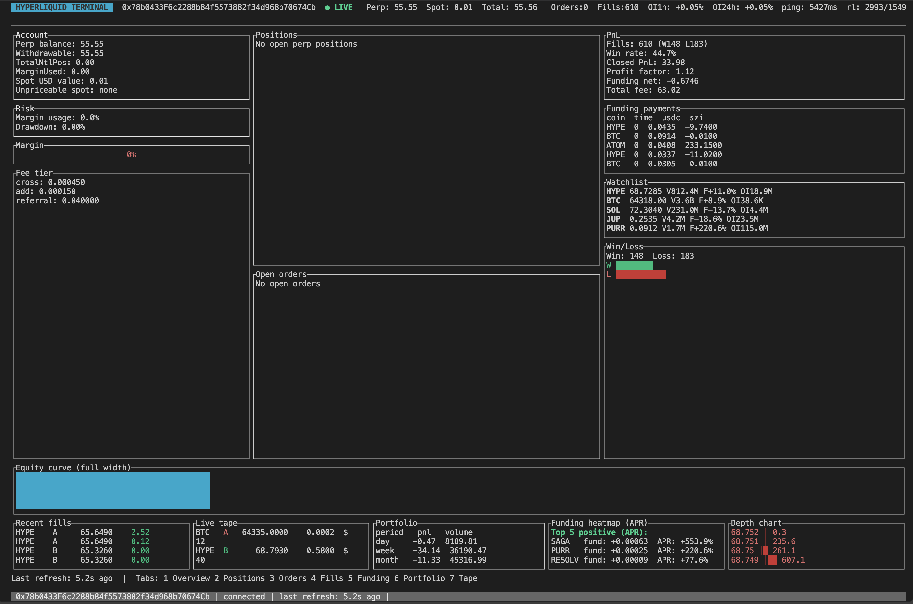

# Hyperliquid Terminal

<p align="center">
  
</p>

**Hyperliquid Terminal** (`hl-monitor`) is a fast, single-panel terminal dashboard for
monitoring **your own Hyperliquid account**: positions, open orders, fills, funding
payments, PnL, equity and risk — live, in one screen.

It is a **read-only monitor**. It never places, modifies or cancels orders, and it
never sends your private key anywhere. It only reads the public data Hyperliquid
already exposes for your account address.

---

## What you get

| Panel | What it shows |
|---|---|
| **Header** | Perp balance, spot value, total equity, order/fill counts, OI change (1h/24h), API latency, rate-limit usage |
| **Account / Risk** | Perp balance, withdrawable, margin usage with gauge, drawdown, equity peak (border turns red above 70% margin) |
| **Positions / Orders** | Open perp positions with unrealized PnL, leverage and liquidation-distance bars; all open orders |
| **PnL / Funding** | Win rate, closed PnL, profit factor, total fees, funding net, per-payment history |
| **Watchlist** | A fixed 5-coin monitoring universe — **HYPE** (main asset), **BTC** (market direction), **SOL** (liquidity), **JUP** (DEX sector), **PURR** (Hyperliquid ecosystem) — each with price, 24h volume, funding APR and open interest |
| **Live tape** | Streaming trades across all 5 watchlist coins; trades ≥ $50k are flagged 🐋 |
| **Depth chart** | Cumulative bid/ask depth bars from the HYPE order book |
| **Equity curve** | Rolling equity sparkline |

**Sound & desktop alerts:** a beep + desktop notification fires when a position
opens (880 Hz) or closes (440 Hz). Position flips (long → short) are detected as
a close + an open. Requires `pw-play` (PipeWire) and `notify-send` on Linux;
without them the rest of the monitor works fine.

**Data completeness:** fill history is paginated beyond the API's 2,000-record
window via `userFillsByTime`, funding is paginated across 30-day windows with
inclusive cursors, and the UI shows an explicit ⚠ warning if any history had to
be truncated — so the numbers you see never pretend to be more complete than
they are.

---

## Quick start

You need **Rust** (1.75+) and a Linux/Unix shell. Check: `rustc --version`

```bash
# 1. Get the code
git clone https://github.com/servetkarckay/hl-monitor.git
cd hl-monitor

# 2. Create your config from the template
cp .env.example .env

# 3. Open .env with any editor and paste YOUR wallet address
#    (where to find it is explained inside the file)
nano .env

# 4. Build and run
cargo run --release
```

That's it — the dashboard opens in your terminal.

> **The only value you really need to fill in is `USER_ADDRESS`** — your own
> Hyperliquid wallet address, copied from [app.hyperliquid.xyz](https://app.hyperliquid.xyz).
> Everything else can stay at its defaults; the template explains each value
> in plain language.

### Full-coin tape mode

To stream trades and watch the whale tape across all five watchlist coins:

```bash
cargo run --release -- --coins HYPE,BTC,SOL,JUP,PURR --interval 2
```

### Command-line options

| Flag | Meaning | Default |
|---|---|---|
| `--coins A,B,C` | Coins to stream on the live tape (first coin = the market whose OI is tracked in the header) | `HYPE,BTC,SOL,JUP,PURR` |
| `--interval SECONDS` | Snapshot refresh period (minimum 2) | `10` |
| `--funding-days N` | How far back to page funding history | `90` |
| `--fills-limit N` | Fill rows kept in memory | `500` |
| `--once` | Print one snapshot as text and exit (no UI) | off |

### Keys

| Key | Action |
|---|---|
| `q` / `Ctrl+C` | Quit |
| `/` | Filter the live tape by coin (then `Enter`; `c` clears) |
| `e` | Export fills to a CSV in your temp directory |
| `?` | Help overlay |
| `↑ ↓` `k j` `PgUp PgDn` | Scroll |

---

## Security

This is a monitoring tool, and its design is deliberately paranoid:

- **Read-only.** There is no code path that signs or sends an order.
- **Your key is never needed.** The monitor only requires *some* valid 32-byte
  hex key to initialize its HTTP client; the `.env.example` ships with a public
  test key that controls nothing.
- **Secrets stay local.** `.env` is gitignored; the code never logs or transmits
  your values.

Please read [SECURITY.md](SECURITY.md) before running anything, and
[CONTRIBUTING.md](CONTRIBUTING.md) if you want to help.

---

## Data sources

All data comes from **Hyperliquid's own API** (Info REST endpoints + WebSocket):
`clearinghouseState`, `spotClearinghouseState`, `spotMeta`, `frontendOpenOrders`,
`userFills`/`userFillsByTime`, `userFunding`, `userFees`, `portfolio`, `allMids`,
`metaAndAssetCtxs`, `userRateLimit`, and the `trades`/`userEvents` streams.
No third-party data providers.

Spot token values are priced through the `spotMeta` token → market mapping so
balances are never silently valued at zero or against a same-name perp.

---

## License

This project is released under the [MIT License](LICENSE) — free to use,
modify, distribute and even sell, as long as the copyright notice stays.

## Disclaimer

This project is for personal account monitoring. It is not financial advice,
not a trading bot, and not affiliated with Hyperliquid. Markets carry risk —
verify anything important before acting on it.
